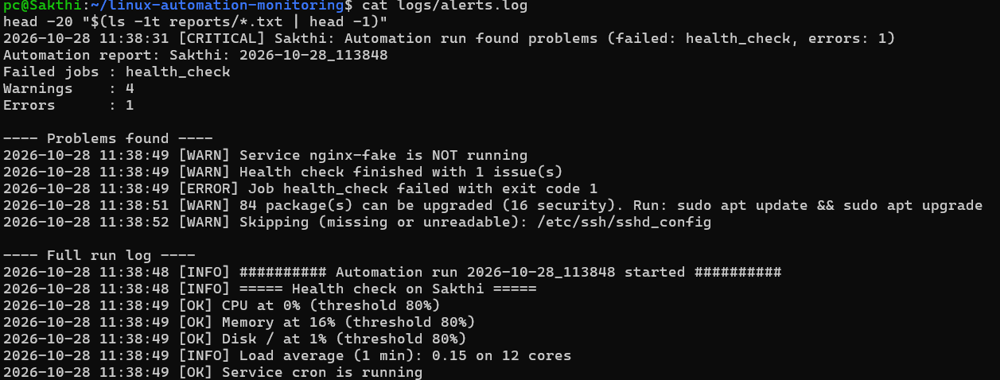
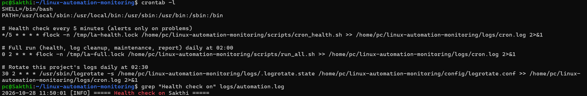
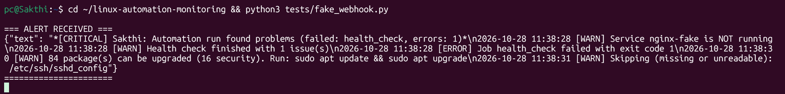
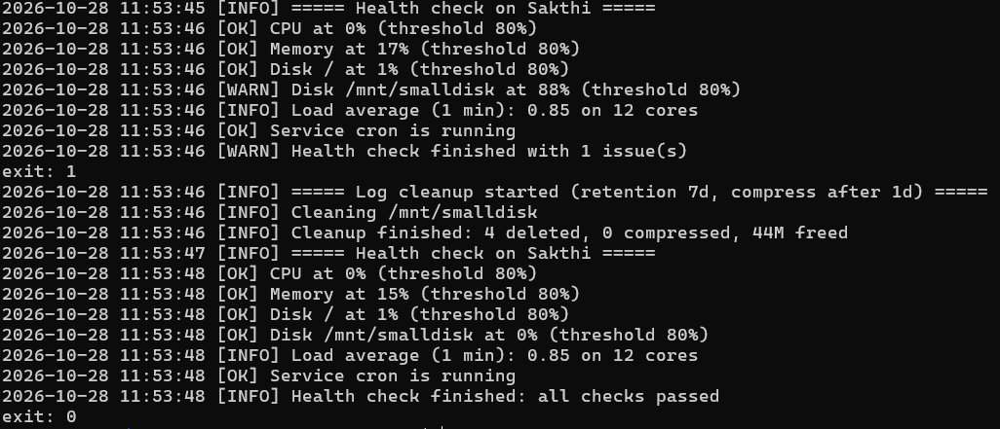

# Linux Automation & Monitoring

A set of Bash scripts that automate routine Linux server administration: health checks, log cleanup, maintenance tasks, summary reports, and alerting. Cron runs them on a schedule, and the scripts are built to be safe to run unattended: they support dry-run mode, refuse to touch system directories, never overlap, and rotate their own logs.



## What it does

| Job | Script | What happens |
|---|---|---|
| Health check | `scripts/health_check.sh` | Checks CPU, memory, disk (one or more mounts), load average, and required services against configurable thresholds. Exits `0` when healthy and `1` when not. |
| Log cleanup | `scripts/log_cleanup.sh` | Deletes logs and archives past the retention period, compresses older logs, and reports the space freed. Supports `--dry-run`. |
| Server maintenance | `scripts/server_maintenance.sh` | Reports pending package updates (security count included), removes old temp files, reports the largest folders, and takes a dated config backup while keeping only the newest N. |
| Full run and report | `scripts/run_all.sh` | Runs all three jobs, keeps going if one fails, writes a per-run report, and alerts on failed jobs or errors. |
| Frequent health check | `scripts/cron_health.sh` | Runs the health check with an alert cooldown, so a persistent problem alerts once instead of every few minutes. |

## Repository structure

```
.
├── scripts/
│   ├── lib.sh                  # shared settings, logging, dry-run wrapper, alerting
│   ├── health_check.sh
│   ├── log_cleanup.sh
│   ├── server_maintenance.sh
│   ├── run_all.sh
│   └── cron_health.sh
├── config/
│   ├── settings.conf           # thresholds and paths (all overridable by environment variables)
│   └── logrotate.conf
├── cron/
│   └── crontab.example
├── tests/
│   ├── fake_webhook.py         # local receiver to test alert delivery
│   └── time_runs.sh            # times repeated runs and prints the median
├── docs/
│   ├── measurements.md
│   └── screenshots/
└── logs/ reports/ backups/     # generated at runtime, git-ignored
```

## Setup

```bash
git clone https://github.com/Sakthi-312/linux-automation-monitoring.git
cd linux-automation-monitoring
chmod +x scripts/*.sh tests/*.sh

# Try everything without changing anything
./scripts/run_all.sh --dry-run

# Real run
./scripts/run_all.sh
```

Reports are written to `reports/`, and logs to `logs/automation.log` and `logs/alerts.log`.

## Configuration

Every setting lives in `config/settings.conf` and can be overridden for a single run with an environment variable:

```bash
CPU_THRESHOLD=70 DISK_PATHS="/ /var" SERVICES="cron ssh" ./scripts/health_check.sh
```

| Variable | Default | Purpose |
|---|---|---|
| `CPU_THRESHOLD`, `MEM_THRESHOLD`, `DISK_THRESHOLD` | 80 | Warning thresholds (%) |
| `DISK_PATHS` | `/` | Mounts to check |
| `SERVICES` | `cron` | Process names that must be running |
| `LOG_RETENTION_DAYS` | 7 | Delete logs older than this |
| `COMPRESS_AFTER_DAYS` | 1 | Compress logs older than this |
| `CLEANUP_DIRS` | project `logs/` | Folders the cleanup job manages |
| `TMP_DIRS`, `TMP_RETENTION_DAYS` | `/tmp`, 3 | Temp cleanup (only files owned by the current user) |
| `BACKUP_SOURCES`, `BACKUP_DIR`, `BACKUP_KEEP` | key files in `/etc`, `backups/`, 5 | Config backup |
| `ALERT_COOLDOWN_MIN` | 60 | Minimum minutes between repeated health alerts |
| `SLACK_WEBHOOK_URL` | unset | Put in `config/.env` (git-ignored), never in the repository |

## Scheduling with cron

`cron/crontab.example` contains the schedule. Replace `/home/pc` with your home directory, then install it:

```bash
sed "s|/home/pc|$HOME|g" cron/crontab.example | crontab -
crontab -l
```

| Schedule | Command | Purpose |
|---|---|---|
| Every 5 minutes | `cron_health.sh` | Health check, alerts on problems |
| Daily 02:00 | `run_all.sh` | Cleanup, maintenance, backup, report |
| Daily 02:30 | `logrotate` | Rotate this project's own logs |

Each job runs under `flock -n`, so a slow run never overlaps the next one. Cron starts with a minimal environment, so the crontab sets `PATH` and uses absolute paths throughout.



## Alerting

An alert is sent only when a job fails or an error is logged. Warnings (for example "84 packages upgradable") go into the report but do not alert, which prevents alert fatigue. Alerts are written to `logs/alerts.log` and, if `SLACK_WEBHOOK_URL` is set, posted to a Slack-compatible webhook.

`tests/fake_webhook.py` is a local receiver for testing:

```bash
python3 tests/fake_webhook.py                      # terminal 1
export SLACK_WEBHOOK_URL=http://127.0.0.1:9000/hook
SERVICES="cron nginx-fake" ./scripts/cron_health.sh   # terminal 2
```



## Design decisions

- **Dry-run mode.** Every command that changes something goes through a wrapper, so `--dry-run` prints exactly what would happen and changes nothing.
- **Safety checks.** The cleanup and maintenance jobs refuse to run on `/`, `/etc`, `/usr`, `/home`, and other system directories, so a bad config value cannot cause damage.
- **Idempotent.** Running a job twice produces the same result. The second run does nothing.
- **Exit codes.** `0` means healthy and non-zero means a problem, so the scripts compose with cron and other tools.
- **Isolated failures.** `run_all.sh` does not stop at the first failure. It collects every failed job and reports them together.
- **No secrets in Git.** Webhook URLs live in a git-ignored file.

## Testing with simulated incidents

**High CPU**

```bash
for i in $(seq "$(nproc)"); do yes > /dev/null & done
sleep 2
./scripts/health_check.sh; echo "exit: $?"      # CPU warning, exit 1
kill $(jobs -p)
```

**Disk fills up, then the automation fixes it** (uses a small 50 MB in-memory disk, so no real disk is at risk):

```bash
sudo mkdir -p /mnt/smalldisk && sudo mount -t tmpfs -o size=50M tmpfs /mnt/smalldisk
sudo chown "$USER" /mnt/smalldisk
for i in 1 2 3 4; do
  dd if=/dev/zero of=/mnt/smalldisk/app$i.log bs=1M count=11 status=none
  touch -d "10 days ago" /mnt/smalldisk/app$i.log
done

DISK_PATHS="/ /mnt/smalldisk" ./scripts/health_check.sh        # warning at 88%
CLEANUP_DIRS=/mnt/smalldisk ./scripts/log_cleanup.sh           # frees the space
DISK_PATHS="/ /mnt/smalldisk" ./scripts/health_check.sh        # healthy again

sudo umount /mnt/smalldisk && sudo rmdir /mnt/smalldisk
```



## Measured results

`tests/time_runs.sh` times repeated full runs.

| Measurement | Result |
|---|---|
| Scripted routine (`run_all.sh`), median of 5 runs | 4.1 s (first run 8.2 s with a cold disk cache) |
| Same routine done manually, typed by hand | **REPLACE: your own stopwatch time, see docs/measurements.md** |

The scripted figure measures the routine's runtime. It does not remove the need to read reports and act on alerts.

## Limitations and future work

- Tested on Ubuntu under WSL2. Cron only runs while WSL is running. On a normal Linux server the same crontab works unchanged.
- It covers a single host. A natural next step is running the same scripts across many servers with Ansible.
- Add email alerting, and export metrics to Prometheus through node_exporter.
- Add automated tests (for example with `bats`) for the scripts' logic.

## Author

**Sakthivel M**: [GitHub](https://github.com/Sakthi-312) | [LinkedIn](https://www.linkedin.com/in/sakthi-vel-86b3a21b0)
